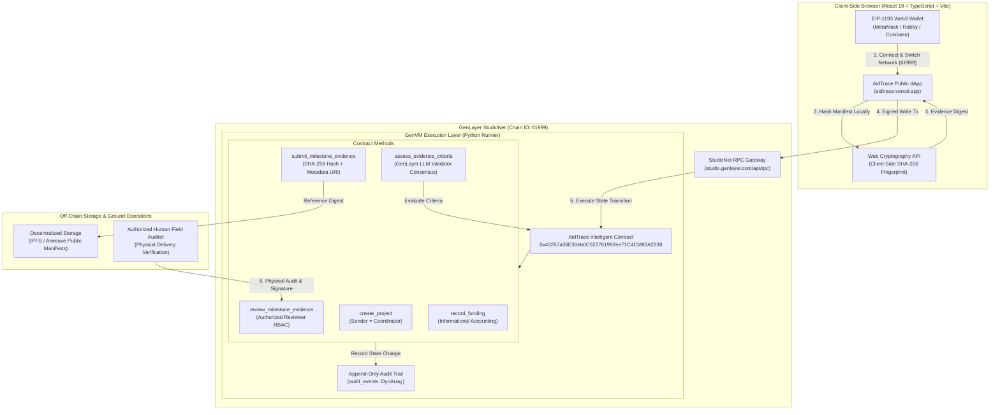
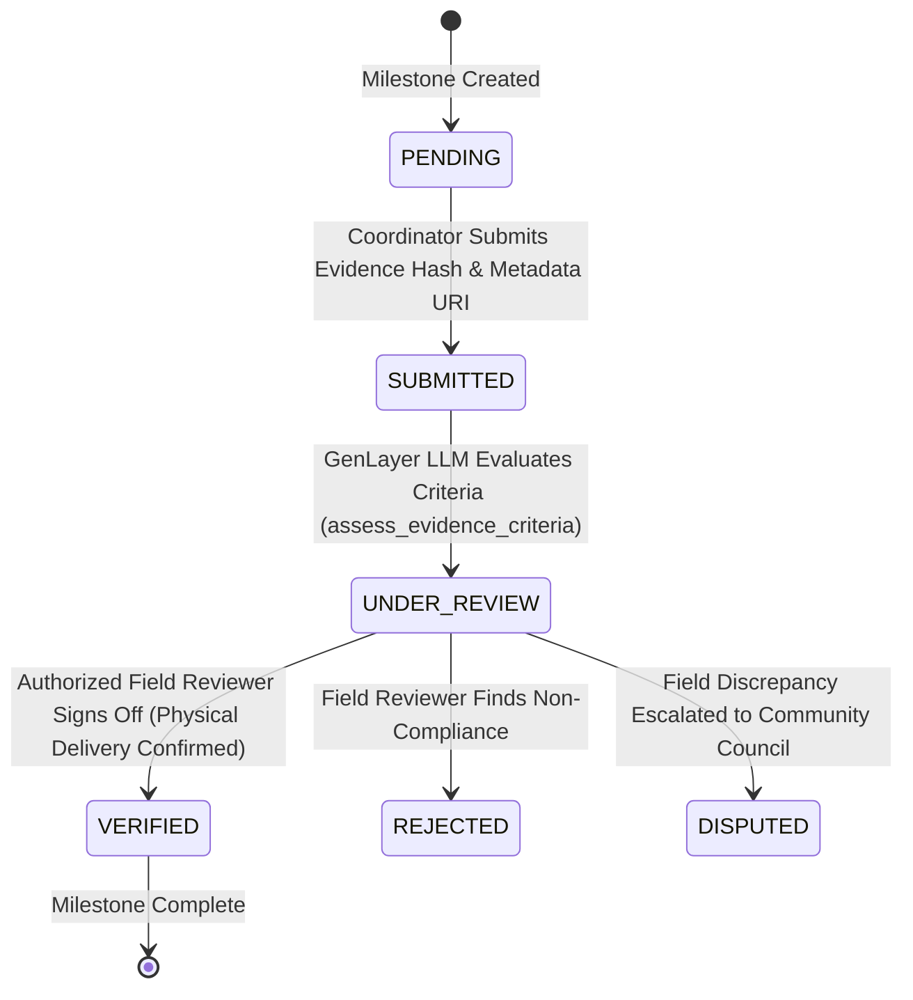
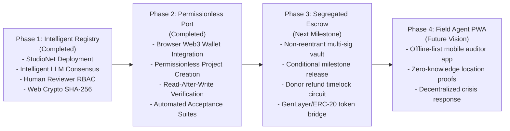

# AidTrace — Transparent Aid. Verifiable Impact.

<div align="center">


[](https://aidtrace.vercel.app)
[-blue?style=for-the-badge&logo=ethereum&logoColor=white)](https://studio.genlayer.com)
[](https://studio.genlayer.com)
[](#7-testing--verification-suites)
[](#7-testing--verification-suites)
[-brightgreen?style=for-the-badge)](#7-testing--verification-suites)
[](LICENSE)

**An intelligent, privacy-preserving humanitarian infrastructure bridging GenLayer intelligent validator consensus, client-side zero-knowledge evidence hashing, and authorized human auditor attestations.**

[Explore Live dApp](https://aidtrace.vercel.app) • [View Video Demo](#-video-demo--interactive-runbook) • [Quick CLI Verification](#6-interactive-quickstart--judge-verification-guide) • [Architecture Specification](#4-system-architecture--data-flow)

</div>

---

## 📌 Executive Summary

| Attribute | Specification |
| :--- | :--- |
| **Hackathon Track** | **Tech Track — Web3 for Social Good Hackathon 2026** |
| **Primary Network** | **GenLayer StudioNet** (Chain ID: `61999`, RPC: `https://studio.genlayer.com/api/rpc`) |
| **Live Contract Address** | [`0x43257a38E30eb0C522761992ee71C4Cb9f2A2338`](file:///C:/Users/NO%20GO%20NO/aidtrace/contracts/aid_trace.py) |
| **GenVM Runner** | `py-genlayer:1jb45aa8ynh2a9c9xn3b7qqh8sm5q93hwfp7jqmwsfhh8jpz09h6` (pinned) |
| **Production URL** | [https://aidtrace.vercel.app](https://aidtrace.vercel.app) |
| **Source Repository** | [https://github.com/JimmyOgb/AidTrace-](https://github.com/JimmyOgb/AidTrace-) |
| **EVM Baseline Reference** | [`contracts/AidTraceCore.sol`](file:///C:/Users/NO%20GO%20NO/aidtrace/contracts/AidTraceCore.sol) (19 passing Hardhat unit tests preserved) |
| **Budget Constraint** | Strictly **$0.00 USD** (Free testnets, zero paid SaaS, gasless StudioNet execution) |

---

## Table of Contents

1. [The Crisis in Humanitarian Aid](#1-the-humanitarian-crisis--the-problem)
2. [What is AidTrace?](#2-what-is-aidtrace)
3. [Key Innovations & Technical Breakthroughs](#3-key-innovations--technical-breakthroughs)
4. [System Architecture & Data Flow](#4-system-architecture--data-flow)
5. [Intelligent Contract Anatomy (`aid_trace.py`)](#5-intelligent-contract-anatomy-aid_tracepy)
6. [Interactive Quickstart & Judge Verification Guide](#6-interactive-quickstart--judge-verification-guide)
7. [Testing & Verification Suites](#7-testing--verification-suites)
8. [Security, Privacy & Responsible AI Framework](#8-security-privacy--responsible-ai-framework)
9. [Roadmap: Future Segregated Escrow Vault](#9-roadmap-segregated-escrow-vault)
10. [License & Team](#10-license--team)

---

## 1. The Humanitarian Crisis & The Problem

Over **$30 Billion** in humanitarian and international relief aid is distributed globally each year. Despite the heroic efforts of frontline organizations, the sector suffers from structural systemic failures:

1. **The Accountability Black Hole ("Phantom Aid"):** Traditional donors (individuals, philanthropic funds, and governments) surrender visibility the moment funds leave their accounts. Intermediary administrative overhead, currency conversion fees, and bureaucratic opacity erode impact.
2. **The "Paper Trail vs. Real World" Dilemma:** Impact is frequently measured through easily fabricated PDFs, staged photographs, and unverifiable spreadsheets. There is no cryptographic link between declared outcomes and verifiable on-the-ground reality.
3. **The Beneficiary Privacy Paradox:** When humanitarian projects attempt transparency, they frequently commit catastrophic privacy blunders—publishing photographs, names, or biometric data of vulnerable displaced persons on public ledgers or social media, violating GDPR and endangering lives.
4. **The Oracle / Automation Fallacy:** Blindly automating fund distribution via standard EVM smart contracts or pure AI bots is dangerous. Pure code cannot know if clean water is actually flowing from a newly drilled borehole; an algorithm can easily hallucinate physical delivery.

---

## 2. What is AidTrace?

**AidTrace** is a next-generation decentralized application engineered on **GenLayer**. It replaces blind trust with **cryptographically verifiable impact**, combining:

- **Permissionless On-Chain Project Creation:** Any humanitarian initiative can connect an EIP-1193 Web3 wallet on GenLayer StudioNet, register verifiable milestones, and commit to transparent delivery metrics without centralized gatekeeping.
- **Intelligent LLM Consensus (`assess_evidence_criteria`):** Independent GenLayer validators run non-deterministic consensus to evaluate whether submitted milestone documentation, receipts, and manifests genuinely satisfy stated criteria.
- **The Dual-Validation Safety Principle:** AI assessment provides objective criteria screening, but **never authorizes fund release or claims physical delivery alone**. Verification strictly requires an explicit on-chain digital signature from an **authorized human field auditor** (`review_milestone_evidence`).
- **Zero-PII Cryptographic Evidence Vault:** Physical manifests, sensor readings, and ground photos are fingerprinted client-side using the native Web Cryptography API (`SHA-256`). Only the cryptographic hash is committed to the blockchain; zero personally identifiable beneficiary information ever touches the chain.
- **Truthful Financial Separation:** AidTrace explicitly separates informational accounting records from custodial fund transfers. We refuse to simulate or fabricate fake token transfers, providing complete transparency into contract capabilities.

---

## 3. Key Innovations & Technical Breakthroughs

### 🧠 1. GenLayer Intelligent Consensus for Criteria Evaluation
Traditional blockchains can only verify deterministic mathematics (e.g. `2 + 2 = 4` or signature validation). AidTrace harnesses GenLayer's **GenVM** to execute subjective, natural-language evaluations directly inside the smart contract:
```python
# GenLayer intelligent consensus prompt executed across independent validators
prompt = f"""
Evaluate if the following milestone evidence meets the stated criteria.
Project Title: {project['title']}
Milestone Title: {m['title']}
Required Target Outcome: {m['target_outcome']}
Submitted Evidence Metadata: {evidence_summary}

Respond with exactly one word: SATISFIED, INSUFFICIENT, or CONTRADICTORY.
"""
result = gl.nondet.exec_prompt(prompt).strip().upper()
```

### 🛡️ 2. The Dual-Validation Principle (AI + Human Field Reviewer)
To protect against the **Oracle Fallacy** and **Automation Bias**:
- **Step A — Validator Consensus (`assessment_status`):** GenLayer validators inspect evidence metadata against stated benchmarks.
- **Step B — Field Reviewer RBAC (`review_status`):** An authorized human auditor on the ground inspects physical delivery and submits an attestation (`VERIFIED`, `REJECTED`, or `DISPUTED`) along with an in-memory SHA-256 fingerprint of their audit rationale.
- **Both distinct statuses** remain permanently recorded in the on-chain audit trail.

### 🌐 3. Permissionless On-Chain Project Creation & Identity Binding
Anyone with a Web3 wallet can register a project directly on GenLayer StudioNet. Crucially:
- The coordinator address is **never trusted from client form inputs**.
- The contract strictly derives and enforces `project["coordinator"] = str(gl.message.sender_address).lower()`.
- Client-side pre-submission validation blocks negative targets, invalid JSON, or empty milestone arrays.
- Automatic double-submission locking prevents accidental duplicate transactions while in-flight.
- Immediate read-after-write verification queries the contract to verify state before displaying success.

### 🔒 4. Zero-PII Client-Side Web Cryptography
AidTrace enforces strict humanitarian data protection (GDPR / ICRC standards):
- Photos and manifests are processed **entirely in the user's browser** using `crypto.subtle.digest("SHA-256", buffer)`.
- No sensitive raw media or beneficiary names are transmitted to servers or blockchains.
- The public and auditors can drag-and-drop any delivery receipt file into AidTrace's in-browser verifier to recompute its SHA-256 hash and match it instantly against the immutable on-chain record.

### ⚖️ 5. Honest Financial Architecture: Accounting vs. Escrow
Many Web3 social impact prototypes simulate fake token transfers or disguise simple string records as live financial escrows. AidTrace establishes an industry benchmark for honesty:
- `record_funding` is explicitly labeled and documented as **Informational Accounting**.
- Financial contributions remain disabled in the UI until our verified **Segregated Escrow Vault** contract is deployed.
- Donors and reviewers are never misled into believing testnet string records equal real-world escrow settlements.

---

## 4. System Architecture & Data Flow



### Milestone Verification State Machine



---

## 5. Intelligent Contract Anatomy (`aid_trace.py`)

The primary contract [`contracts/aid_trace.py`](file:///C:/Users/NO%20GO%20NO/aidtrace/contracts/aid_trace.py) is authored in Python for the GenLayer GenVM with pinned runner version:
```python
# { "Depends": "py-genlayer:1jb45aa8ynh2a9c9xn3b7qqh8sm5q93hwfp7jqmwsfhh8jpz09h6" }
```

### Contract Methods Matrix

| Method Name | Visibility | Access Guard | Description |
| :--- | :--- | :--- | :--- |
| `create_project` | `@gl.public.write` | Public (Sender becomes Coordinator) | Registers new project with title, description, location, target, and outcome criteria. |
| `set_project_status` | `@gl.public.write` | Coordinator or Admin | Updates status (`ACTIVE`, `PAUSED`, `COMPLETED`, `CANCELLED`). |
| `add_milestone` | `@gl.public.write` | Coordinator or Admin | Appends a target milestone with title, outcome criteria, and budget allocation. |
| `submit_milestone_evidence` | `@gl.public.write` | Coordinator or Admin | Commits SHA-256 evidence hash and IPFS metadata URI. |
| `assess_evidence_criteria` | `@gl.public.write` | Public / Evaluator | Triggers GenLayer non-deterministic LLM consensus evaluation on criteria alignment. |
| `review_milestone_evidence` | `@gl.public.write` | Authorized Reviewer (`RBAC`) | Records definitive human attestation (`VERIFIED`, `REJECTED`, or `DISPUTED`). |
| `record_funding` | `@gl.public.write` | Public | Logs informational funding accounting entry (amount & donor memo). |
| `set_reviewer_authorization` | `@gl.public.write` | Admin Only | Whitelists or revokes authorized third-party auditor addresses. |
| `get_project` | `@gl.public.view` | Public (Gasless) | Returns complete JSON-encoded project record. |
| `get_milestones` | `@gl.public.view` | Public (Gasless) | Returns all milestones registered under a given project ID. |
| `get_project_count` | `@gl.public.view` | Public (Gasless) | Returns current total number of projects registered on-chain. |
| `get_audit_trail` | `@gl.public.view` | Public (Gasless) | Returns append-only log of all historical contract events. |

---

## 6. Interactive Quickstart & Judge Verification Guide

Judges can verify AidTrace in **under 2 minutes** via the web application or directly via the command line.

### Option A: Verify Live Web dApp (Zero Setup)
1. Navigate to **[https://aidtrace.vercel.app](https://aidtrace.vercel.app)**.
2. Click **Connect Wallet** in the top navigation. If connected to Ethereum Mainnet or Base Sepolia, the app will automatically prompt you to switch or add **GenLayer StudioNet** (`Chain ID: 61999`).
3. Click **+ Create Project** in the navigation bar to open the permissionless project creation modal.
4. Input test data (e.g., Title: *"Sub-Saharan Solar Cold-Chain Initiative"*, Target: *"25 ETH"*, 1 verifiable milestone).
5. Review the pre-flight transaction summary screen (displaying contract address, method, and consequences).
6. Sign the gasless transaction in your Web3 wallet. Watch the live consensus status update, wait for the receipt, and inspect the verified on-chain project card rendered instantly via read-after-write polling!
7. Scroll down to the **Cryptographic Evidence Verifier**, drag and drop any test manifest file, and verify its computed SHA-256 hash against the on-chain record.

### Option B: Verify Directly via GenLayer CLI (Terminal)
Ensure you have Python 3.12+ and `genlayer-cli` installed:

```bash
# 1. Query total on-chain projects
genlayer call 0x43257a38E30eb0C522761992ee71C4Cb9f2A2338 get_project_count

# 2. Query Project #1 (Horn of Africa Emergency Water Logistics)
genlayer call 0x43257a38E30eb0C522761992ee71C4Cb9f2A2338 get_project --args 1

# 3. Query Project #1 Milestones
genlayer call 0x43257a38E30eb0C522761992ee71C4Cb9f2A2338 get_milestones --args 1

# 4. Inspect the immutable append-only audit trail
genlayer call 0x43257a38E30eb0C522761992ee71C4Cb9f2A2338 get_audit_trail
```

---

## 7. Testing & Verification Suites

AidTrace maintains **100% test pass rate** across all contract, frontend, linting, and build suites.

```
================================ TEST SUITE SUMMARY ================================
✔ GenLayer Python Direct Tests:      14 / 14 Passing (pytest tests/direct/)
✔ Frontend Flow & Validation Tests:  18 / 18 Passing (Node.js native test runner)
✔ EVM Baseline Regression Tests:     19 / 19 Passing (Hardhat tests/AidTraceCore.test.ts)
✔ GenVM Contract Linter:             0 Errors, ok: true (genvm-lint)
✔ TypeScript Strict Compilation:     0 Errors (tsc --noEmit)
✔ Production Vite Build:             Clean 4.26s bundle (dist/)
=====================================================================================
```

### Reproduce Verification Locally

```bash
# 1. Clone repository
git clone https://github.com/JimmyOgb/AidTrace-.git
cd AidTrace-

# 2. Install dependencies
npm install

# 3. Run GenLayer Intelligent Contract Direct Tests
npm run test:genlayer
# Output: 14 passed in 23.22s

# 4. Run Frontend Transaction Flow & Validation Tests
npm run test:frontend
# Output: 18 passing tests (0 failures)

# 5. Run GenVM Contract Syntax & Semantics Linter
npm run lint:genlayer
# Output: {"ok": true, "lint": {"ok": true, "passed": 3}}

# 6. Run TypeScript Typecheck
npm run typecheck
# Output: Exit code 0

# 7. Compile Production Web Bundle
npm run build
# Output: ✓ built in 4.26s (dist/ generated cleanly)
```

### Direct Contract Test Breakdown (`tests/direct/test_aid_trace.py`)
1. `test_contract_initialization`: Verifies admin address and deployer authorization.
2. `test_set_reviewer_authorization`: Confirms role-based access control for field auditors.
3. `test_unauthorized_set_reviewer_rejected`: Ensures non-admins cannot whitelist reviewers.
4. `test_create_project_valid`: Tests parameter storage and coordinator assignment.
5. `test_create_project_empty_fields_rejected`: Tests fail-closed validation on empty strings.
6. `test_create_project_negative_beneficiaries_rejected`: Rejects negative beneficiary counts.
7. `test_set_project_status_coordinator_success`: Verifies coordinator lifecycle transitions.
8. `test_set_project_status_unauthorized_rejected`: Prevents third-party project tampering.
9. `test_add_milestone`: Tests sequential milestone creation and indexing.
10. `test_submit_milestone_evidence`: Commits cryptographic hash and metadata URI.
11. `test_assess_evidence_criteria`: Evaluates GenLayer LLM criteria evaluation consensus.
12. `test_review_milestone_evidence_authorized`: Tests human reviewer signature sign-off.
13. `test_review_milestone_evidence_unauthorized_rejected`: Blocks unauthorized reviewer signatures.
14. `test_permissionless_creation_and_independent_read`: Proves Wallet A creates a project and Wallet B can independently inspect on-chain state without permission.

---

## 8. Security, Privacy & Responsible AI Framework

AidTrace adheres to the highest humanitarian data protection standards:

| Principle | Technical Enforcement Mechanism |
| :--- | :--- |
| **Zero Personally Identifiable Information (PII)** | Never store beneficiary names, biometric records, or coordinates on-chain. Aggregate beneficiary targets only (e.g. `500 households`). |
| **Cryptographic Evidence Fingerprinting** | Client-side in-browser Web Cryptography API (`crypto.subtle.digest`). Only the 32-byte SHA-256 digest is stored on-chain. |
| **Separation of Concerns: AI vs. Human** | GenLayer LLM consensus evaluates criteria compliance; **only** authorized human field auditors can transition a milestone to `VERIFIED`. |
| **Access Control (RBAC)** | Strict address checks using `gl.message.sender_address`. Non-coordinators cannot update project state; non-reviewers cannot sign attestations. |
| **Fail-Closed Architecture** | Any malformed parameter, empty title, unauthorized signature, or non-existent milestone ID immediately triggers a deterministic `gl.vm.UserError`. |
| **Transparent Truth in UI** | Clear warnings that `record_funding` is informational accounting; monetary contribution buttons disabled until escrow deployment. |

---

## 9. Roadmap: Segregated Escrow Vault

AidTrace's development trajectory for mainnet readiness:



### Segregated Escrow Architecture (Phase 3 Specification)
1. **Independent Escrow Vault:** Rather than commingling funds within the core logic contract, a standalone audited smart contract will hold testnet/mainnet ERC-20 stablecoins.
2. **Conditional Milestone Release:** Vault will release funds to the project coordinator **only** when the core contract reports `status == "VERIFIED"` by an authorized field auditor.
3. **Emergency Donor Refund Circuit:** If a project fails to achieve verified milestones within a designated timelock window, donors can trigger an automated proportional refund.

---

## 10. License & Team

### Open Source License
This project is open-source software licensed under the **[MIT License](LICENSE)**.

### Hackathon Submission Notes
Developed with passion for the **Web3 for Social Good Hackathon 2026**.
- **Live dApp:** [https://aidtrace.vercel.app](https://aidtrace.vercel.app)
- **Deployed Contract:** [`0x43257a38E30eb0C522761992ee71C4Cb9f2A2338`](https://studio.genlayer.com)
- **Primary Contact / Author:** [Jimmy Ogb (GitHub: @JimmyOgb)](https://github.com/JimmyOgb)

<div align="center">

**Transparent Aid. Verifiable Impact. Zero Compromises.**

</div>
